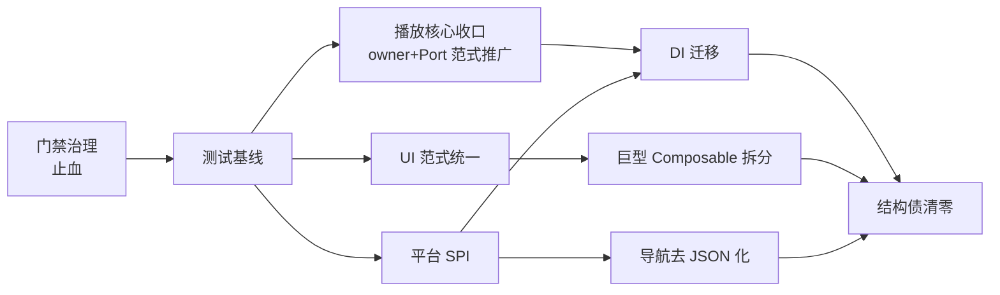

# NeriPlayer 多维度整改建议方案

> 前置文档：[NeriPlayer-架构点评.md](./NeriPlayer-架构点评.md)
> 方案性质：**只给整改路径，不改任何业务代码**。文中所有接口/类型均为"目标设计示意"，不是可直接提交的源码。
> 编写日期：2026-11-16
> 证据基线：`main` @ `c60f846`，工作区带未提交的 QQ 音乐改动

---

## 0. 怎么用这份方案

### 0.1 三条基本原则

1. **止血优先于美容**：先让门禁全绿、先把破例堵上，再谈结构优化。一个允许破例的门禁等于没有门禁。
2. **每步都可独立回滚**：所有整改都设计成"小步、可验证、可 revert"的独立变更，禁止"一次性大重构"。这个项目有 5000+ 测试和三套门禁，是安全重构的最好底子——前提是按步走。
3. **用类型/结构承载约束，而不是用脚本补丁**：新增平台的违规、UI 状态范式的分裂，根因都是"约束靠人记、靠 Python 脚本白名单"。整改方向是把约束前移到类型系统和模块 API。

### 0.2 三阶段路线图

| 阶段 | 目标 | 维度 | 退出条件 |
|---|---|---|---|
| **第一阶段：止血**（1-2 周） | 门禁全绿、堵破例、建基线 | 门禁治理、Context 穿透、测试基线 | `verifyModularization` 全绿；CI 无红；关键指标有基线数据 |
| **第二阶段：治理**（1-2 月） | 收口全局状态、统一范式、建 SPI | 播放核心、DI、UI 一致性、导航、平台抽象 | PlaybackController 接缝可用；UI 三范式收敛为二；平台 SPI v1 落地 |
| **第三阶段：进化**（持续） | 结构升级、流程固化 | 巨型文件拆分、KMP 评估、ADR/评审流程、合规 | 2000 行文件清零；ADR 流程运转；每季度架构健康度复盘 |

### 0.3 维度间的依赖顺序



**关键依赖**：DI 迁移必须等播放核心和平台 SPI 定形之后——否则你会把今天的坏接口固化进 Hilt 的 `@Module`。这是最容易踩的坑，先做 DI 的人是在用 DI 锁死旧架构。

---

## 1. 维度一：门禁治理（P0，止血）

### 1.1 现状快照

- 复跑 `python3 -B tools_pub/quality/module_boundaries.py`：退出码 1，3 条违规。
  - `PlayerManagerUrlExtensions.kt`：**2082 行，HEAD 即违规**（`git show HEAD:... | wc -l` 实测）。
  - `QQMusicSearchApi.kt`：2 条 forbidden package dependency（`QQMusicSession` / `qqMusicHash33`），来自工作区未提交改动。
- 贴线文件群：`AudioPlayerService.kt` 1998、`UsbExclusiveAudioSink.kt` 1998、`PlayerManagerLifecycleExtensions.kt` 1997、`PlayerManagerPlaybackExtensions.kt` 1991、`PlayerManager.kt` 1977。
- 门禁本身质量很高：白名单、包名归属、DFS 环检测、字节码级 `jdeps` 校验、CRAP 方法级 scope 都是真的。

### 1.2 整改目标

让 `verifyModularization` 成为**零违规的、不可商量的合并门槛**，同时把"行数"这个代理指标改造成真正的早期预警而非数字游戏。

### 1.3 具体步骤

**步骤 1.1 — 清理现存违规（不可跳过）**

1. `PlayerManagerUrlExtensions.kt`（2082 行）按职责边界拆为 2 个文件。探查显示该文件集中了"URL 解析分派 + 四平台结果映射"，建议切口：
   - `PlayerManagerUrlExtensions.kt`：保留中央分派 `resolvePlayableUrl` 与通用逻辑（目标 < 1200 行）；
   - `PlayerManagerUrlPlatformMappings.kt`（新建）：承载 `getQqMusicAudioUrl`(~60 行)、`getBiliAudioUrl`、`getYouTubeSongUrl`、`getNeteaseSongUrl` 四个平台的 `SongUrlResult` 映射函数。
   - 注意：拆分只做代码搬移，不改逻辑、不改签名、不改行为，配 diff 复核。
2. `QQMusicSearchApi.kt` 的两条依赖：`search.api` 包被规则限定只能依赖 `{common, model, network}`。把会话读取与 hash33 的调用**下沉到 `qqmusic` 包内的一个 bridge/repository**（例如让 `QQMusicLyricsRepository` 承担，它已经实现 `NativeLyricSearchApi` 且位置合规），`QQMusicSearchApi` 只保留纯协议调用。
3. 拆分/搬迁后立即重跑门禁 + `:app:testDebugUnitTest` + 相关模块的 `verifyCrap`，确认全绿。

**步骤 1.2 — 把"贴线"变成"预警"**

在 `module_boundaries.py` 里把单一 2000 行硬线改为两级：

| 级别 | 阈值 | 行为 |
|---|---|---|
| 提示（warn） | ≥ 1600 行 | 输出 warning，不阻断，进入周报 |
| 阻断（error） | ≥ 2000 行 | 失败，必须拆 |

同时在 CI 输出一行"距离上限最近 Top 5 文件"的摘要，让结构债**可见**而不是等到爆线才处理。这一条的关键价值是：把团队的注意力从"卡线过关"转移到"提前规划拆解"。

**步骤 1.3 — 门禁自身的演进规则**

- 任何对 `ALLOWED_DEPENDENCIES` / `PACKAGE_OWNERS` / `domain-dependencies.json` 白名单的**新增**条目，必须在 PR 描述里说明原因，且由第二人 approve。当前 2858 条 `allowed_classes` 白名单已是巨大资产，不能让它是"谁都能加一行"。
- 给门禁脚本本身补回归测试：确认脚本拒绝"新增环""新增反向依赖""2082 行文件"三类输入（`tools_pub/quality/test_*.py` 已有 8 个测试文件，在此基础上加即可）。
- 在 `CONTRIBUTING.md` 里写清楚："门禁失败不得以baseline豁免绕过"——README 已经声明不用 baseline，流程上要跟上。

### 1.4 验收标准

- `python3 -B tools_pub/quality/module_boundaries.py` 输出 `Module boundaries: passed`，退出码 0。
- `./gradlew verifyModularization` 全绿（含 CRAP、domain deps、lint）。
- CI 主分支连续 7 天无红。
- 1600 行预警清单建立，并进入整改 backlog。

### 1.5 风险与回退

- 拆分 2082 行文件属于纯搬移，风险低；但要注意该文件含 `when` 分派与 QQ 音乐新增分支，搬移后必须逐平台跑一次播放冒烟（网易云/B站/YouTube/QQ）。
- QQ 音乐的两个违规修复涉及登录态与 hash33，务必保持调用顺序与时机不变，注意登录态过期提示（错误码 2001）行为不回退。

---

## 2. 维度二：播放核心与全局状态收口（P1，治理核心）

### 2.1 现状快照

- `PlayerManager` 1977 行 `object`，32 个 public Flow、约 50 个可变字段、169 处内部 `player` 引用。
- UI 层 **47 个文件**直接 import 该 object；全项目 81 处 `PlayerManager.*collectAsStateWithLifecycle` 分布在 32 个文件；`NowPlayingScreen.kt` 单文件 collect 15 个流。
- **但好消息**：项目已经有一套成熟的 `XxxOwner` + `PlayerManagerXxxPort : XxxPort` 范式（24 个 playback owner、19 个 Port 文件），`PlaybackStatsOwner`、`AudioEffectsOwner`、`PlaybackSoundOwner`、`PlaybackTransportOwner` 等已经在 object 外部承载真实逻辑；`PlaybackSoundOwner.rebindScopes()` 证明 scope 可替换。

### 2.2 整改目标

**不是推翻 `PlayerManager`**，而是：① 先给 UI 一个稳定的读接口（`PlaybackViewState`），让 UI 不再直连 object；② 逐步把 `player`/`application` 注入化，切断全局依赖；③ 把可外置职责按 owner+Port 范式继续搬出。最终 object 退化为一个薄的生命周期协调器。

### 2.3 四步迁移路径（每步独立可回滚）

**步骤 2.1 — 建立 UI 读接缝（收益最大、风险最低）**

定义目标接口示意：

```kotlin
// 目标设计示意，非现状代码
interface PlaybackViewState {
    val currentSong: StateFlow<SongItem?>
    val isPlaying: StateFlow<Boolean>
    val position: StateFlow<Long>
    val duration: StateFlow<Long>
    val queue: StateFlow<List<SongItem>>
    val shuffle: StateFlow<Boolean>
    val repeat: StateFlow<Int>
    // ... 由 UI 实际消费面决定，先用 Top10 Flow
}
```

- 由 `PlayerManager` 实现一个 `object PlayerManagerViewStateAdapter : PlaybackViewState`，内部委托现有 Flow（零行为变化）。
- 从消费面最广的 3 个流（`currentSongFlow` 14 处、`isPlayingFlow` 11 处、`playbackPositionFlow` 9 处）开始，把 UI 的 collect 迁到接口。先改 `NowPlayingScreen`、`LyricsScreen`、`NeriApp` 三个最大消费点，覆盖主要面。
- 接口放在 `modules/playback/runtime` 的 `core/player/host/` 下（与 `PlayerPresentationHost` 等现有接缝同目录）。
- **过渡期允许两套并存**：新代码走接口，旧代码暂留直连，用 CRAP/lint 规则禁止新增直连点。

**步骤 2.2 — 把 player/application 注入化（最难，但外部引用已隔离）**

- 探查证实：`PlayerManager.application` / `player` 的外部直接引用约 50 处，**几乎全部在 `*Port.kt` 适配器里**（USB route/recovery、audio output/route、progress、network resume）。这是天然的收口点。
- 做法：给每个相关 Port 的构造函数传入"运行时句柄"（`Context` + `() -> ExoPlayer?`），由 `PlayerManager` 安装时注入；Port 内部把 `PlayerManager.application/player` 的引用改成句柄。先改 `PlayerManagerPlaybackProgressPort`（2 处）和 `PlayerManagerAudioDeviceRoutePort`（2 处）试水，再推广到引用最多的 `PlayerManagerUsbPlaybackRoutePort`（20+ 处）。
- object 内部的 169 处 `player` 引用不要求一步清零：先接受"内部仍可用"，目标是**外部 Port 不再摸全局**，这一步做完就已经切断了跨模块耦合。

**步骤 2.3 — 按 owner+Port 范式继续外置**

优先外置已经"纯转发"的部分（探查确认最容易先切）：

| 待外置 | 现状 | 目标 |
|---|---|---|
| `playbackSoundStateFlow` / `audioEffectsSettingsFlow` / `audioOutputRouteFlow` / `audioEffectsStatsFlow`（699-706） | PlayerManager 委托 getter | 下沉到 `PlaybackSoundOwner` / `AudioEffectsOwner` 的对外接口 |
| 8 个音效 setter（1384-1419） | PlayerManager 转发 | 同上 |
| 歌词族 public fun（1815-1850，10 个方法） | PlayerManager 代理 | 抽 `LyricsAccess` 接口，委托给现有 lyrics 能力 |
| 歌单/收藏/元数据持久化（1797-1958，约 15 个方法） | PlayerManager 代理 | 抽 `QueueMutationAccess` / `MetadataAccess` |

每搬一组就跑一遍 5000+ 测试，确认行为不变。

**步骤 2.4 — 收敛 watchdog / @Volatile 时序控制**

把 `playbackRuntimeWatchdogToken` / `playbackStartupWatchdogToken` 与两个 watchdog Job 封装为一个 `PlaybackWatchdogOwner`（Port 注入时钟与取消回调），与现有 24 个 owner 并列。这一步纯属结构整理，放在最后做。

### 2.4 验收标准

- UI 层直接 import `PlayerManager` 的文件数从 47 → ≤ 15（且新增代码为 0，用门禁锁死）。
- `PlaybackViewState` 覆盖 Top10 Flow，3 大消费点完成迁移。
- 外部 Port 中 `PlayerManager.application/player` 引用数从 ~50 → 0。
- `PlayerManager.kt` 行数 < 1200。

### 2.5 风险与回退

- 最大风险是 Flow 的 collect 时机变化导致播放状态显示错乱。用"接口内部直接委托原 Flow"的适配器模式可保证零行为变化，每步跑全量测试。
- `lateinit` 初始化顺序（Application 里 `bindApplication` 先于 Compose SideEffect）不能破坏：步骤 2.2 注入句柄时保留现有安装时机。
- 每步一个 PR，可单独 revert。

---

## 3. 维度三：依赖管理演进（P1→P2，谨慎排序）

### 3.1 现状快照

- `AppContainer`（784 行）：42 个懒加载单例（38 个 `by lazy` + 4 个 delegate），被 **108 个文件**引用（main 88）。
- **隐藏的第二套 DI**：`initialize()` 里 10+ 个静态 `*.bind()` / `install*()`（`installPlayerDependencies`、`LocalMediaHostAccess.bind`、`DataHttpClients.bind`、`DownloadQqQualityBridge.playbackQualityProvider = {...}` 等）。
- 命名/类型错位：`qqMusicSearchApi` 属性实际构造的是 `QQMusicLyricsRepository`，`PlayerRepositoryDependencies:42` 同样声明为 `QQMusicLyricsRepository`。
- 无 Hilt/Koin/Dagger；23/31 个 ViewModel 是 `AndroidViewModel`。

### 3.2 整改目标

**先 SPI 后 DI**（见 0.3 依赖顺序）：先把 `AppContainer` 膨胀的根源——"每加一个平台/能力就往容器里塞一个 by lazy + 一堆 when 分支"——用类型系统解决，再谈框架迁移。

### 3.3 分阶段路径

**阶段 A（P1，现在就能做，无框架）：收口命名与职责**

- 修正 `qqMusicSearchApi` 的命名/类型错位：属性名与返回类型统一（`qqMusicLyricsRepository` 或让它真正实现 `SearchApi`）。
- 为 `AppContainer` 的 42 个属性按职责分组加 KDoc 分区（现状已有部分注释），把 784 行的"平铺仓库"读成"按域组织的容器"，降低认知负担。
- 禁止新增 `by lazy` 直接暴露具体平台类：新增能力一律通过维度四的 SPI 注册。

**阶段 B（P2）：引入 DI 框架，过渡期零改动调用点**

- 选型建议：**Hilt**（与 Dagger 生态/AGP 兼容性好，KSP 支持成熟，团队已用 KSP 做设置生成，不引入全新注解处理技术栈）。
- 提供两个 qualifier：`@ApplicationContext`、`@SharedOkHttpClient`；这是绝大多数构造器的共同依赖。
- 迁移顺序（探查已给出易迁移清单）：
  1. 零参/单参叶子：`YouTubePlaybackBootstrapCoordinator`、`CommentMemoryCache`、`BiliSponsorBlockRepository(okHttpClient)`、`LrcLibClient/AmllTtmlClient/KugouLyricsClient`（三歌词仓同一 qualifier）、`BiliPlaybackRepository`。
  2. 需 `@ApplicationContext` 的 repository：`SettingsRepository`、`NeteaseCookieRepository`、`QQMusicSessionStore` 等。
  3. 多协作者：`YouTubeMusicPlaybackRepository`（7 参）、`EditableLyricsMatcher`（6 参）、`ListenTogetherSessionManager`（5 参）。
- **过渡技巧**：让 `AppContainer` 的 42 个属性改成委托 Hilt 容器（`val xxx get() = hiltContainer.xxx()`），108 个调用点零改动，逐个迁移属性而非全量切换。
- 最后处理 `initialize()` 的静态 `bind()`：把它们改为 Hilt 的 `@EntryPoint` 或在 `Application` 中集中安装。

**阶段 C（P2）：ViewModel 减负**

- 24 个 `AndroidViewModel` 中，多数只是为拿 `Application` 创建 repository。DI 接入后改为普通 `ViewModel` + `@Inject constructor`。
- 目标：`AndroidViewModel` 占比从 77% → < 30%。

### 3.4 验收标准

- `AppContainer` 行数 < 400（过渡期结束），最终目标 < 150 或删除。
- 新增业务代码无 `AppContainer.` 直连（门禁加规则：`FORBIDDEN_IMPORT` 扩展或 lint 自定义规则）。
- Hilt 图编译通过，108 个调用点行为不变（全量测试 + 关键链路冒烟）。

### 3.5 风险与回退

- **绝对不要在播放核心 SPI、平台 SPI 定形前做 Hilt**——否则把坏接口固化进 `@Module`，二次迁移成本翻倍。
- Hilt 与多进程（4 个 WebView 登录进程 + service 进程）的组件注入要逐个进程验证，建议先在主进程试点。
- 过渡期"双容器并存"容易漏改：用脚本统计 `AppContainer.` 引用数，每周必须下降。

---

## 4. 维度四：统一平台 SPI（P2，解决"加平台就穿透改 6 处"）

### 4.1 现状快照（能力矩阵）

| 平台 | search | resolvePlayable | playlist | follow/like | comment | lyrics |
|---|---|---|---|---|---|---|
| Netease | ✔ | ✔ | ✔ | ✔ | ✔ | ✔ |
| Bilibili | ✔ | ✔ | ✔ | △ | ✔ | ✘ |
| YouTube | ✔ | ✔ | ✔ | △ | ✘ | ✔ |
| QQMusic | ✔ | ✔ | ✔ | ✘ | △ | ✔ |

- 现有窄接口 5 个（`SearchApi`、`NativeLyricSearchApi`、`CommentRepository`、`BiliAudioDataSource`、`YouTubeAuthProvider`）都是点对点补丁。
- 播放地址解析返回类型四家各异（`BiliAudioStreamInfo` / `YouTubeMusicPlayableAudio` / `QQMusicPlaybackResult` / `SongUrlResult`）。
- 加一个平台要穿透改 6 处：平台模块实现 → `AppContainer` 8 处插入 → `PlayerRepositoryDependencies`(25 成员胖接口) + `AppPlayerBindings` + 下载接口 → `PlayerManagerUrlExtensions` 中央 `when` + track 判定 + 结果映射 → `SearchManager`/`CommentSourceResolver` 分支 → 多个 UI Screen/VM。QQ 音乐这次因此踩穿 2 条包边界规则。

### 4.2 整改目标

把"加平台"从横向穿透式修改，变成"实现接口 + 一次注册"。**不追求大而全的单一接口**——用能力接口组合（ISP 接口隔离原则），避免造一个新的胖接口。

### 4.3 目标设计示意

```kotlin
// 目标设计示意，非现状代码
interface MusicPlatform {
    val source: SongSource            // NETEASE / BILI / YOUTUBE / QQMUSIC
    fun search(): SearchApi?
    fun resolvePlayable(): PlayableResolver?
    fun playlists(): PlaylistAccess?
    fun comments(): CommentRepository?
    fun lyrics(): LyricsProvider?
    fun auth(): PlatformAuth?
}

interface PlayableResolver {
    suspend fun resolve(song: SongItem, quality: QualityKey): PlayableResult
}

// 统一解析结果，消除四家各异的返回类型
sealed interface PlayableResult {
    data class Playable(val url: String, val info: PlaybackAudioInfo) : PlayableResult
    data object LoginRequired : PlayableResult
    data object Unavailable : PlayableResult
}
```

- 注册方式：单一 `PlatformRegistry`，`Map<SongSource, MusicPlatform>`，由 DI 注入。
- 播放分派：`PlayerManagerUrlExtensions` 的中央 `when` 改为 `registry[track.source]?.resolvePlayable()?.resolve(...)`，`isQqTrack`/`isBiliTrack`/`isYouTubeTrack` 三个判定合并为 `SongItem.source` 字段判定（数据模型已含 `channelId`，探查显示 QQ 用 `channelId = "qqmusic"`）。
- 平台专属能力（YouTube PoToken、B站 skip segment、网易云百科）**不塞进 SPI**，保留平台模块内部 + 宿主窄接口注入，符合现状的 `host/` 模式。

### 4.4 迁移步骤

1. 先统一 `PlayableResult` 类型：给四家解析函数加一层适配器，输出统一结果（这一步不改任何调用方，纯新增 mapper）。
2. 定义 `MusicPlatform` 与 6 个能力接口，放在 `modules/model` 或新的 `platform-api` 契约层（注意：不能放 `platform` 实现模块内，否则 network/common 等下游无法依赖）。
3. 四个平台各自实现 `MusicPlatform` 并注册；过渡期保留旧的 `when` 分派，用 feature flag 或 A/B 切换。
4. 全部平台注册完成后，删除中央 `when`、track 判定函数、`PlayerRepositoryDependencies` 中的平台专属成员（25 → 约 8）。
5. `SearchManager` 的 `{ platform -> ... }` lambda 改为注入 `Map<SongSource, SearchApi>`；`CommentSourceResolver` 的 special-case 改为 registry 查询。

### 4.5 验收标准

- 新增一个平台只需：平台模块内实现 + 注册 1 处，不改 `AppContainer`、`PlayerRepositoryDependencies`、`PlayerManagerUrlExtensions`、`SearchManager`、`CommentSourceResolver`。
- `PlayerRepositoryDependencies` 成员数 25 → ≤ 10。
- 质量脚本中 `PACKAGE_DEPENDENCY_RULES` 的逐平台白名单可大幅简化。

### 4.6 风险与回退

- 四家返回类型统一是行为敏感区（音质选项、codec、bitrate、qualityOptions 的映射），必须逐平台对照现有映射函数写等价测试（playback 模块已有 `PlayerManagerPlaybackStartPlanTest` 等，可扩展）。
- `SongItem.channelId` 作为 source 判定的唯一真相源，要确认历史数据/缓存中的 channelId 值稳定（旧字段兼容逻辑在 sync 模块已有先例）。
- 保留旧 `when` 分派直到新路径全量验证通过，可随时回退。

---

## 5. 维度五：UI 架构一致性（P1，三范式收编）

### 5.1 现状快照

- 31 个 ViewModel（24 个 `AndroidViewModel`，占 77%），无基类，每个 VM 各自维护 Job/generation 样板。
- 三范式并存：MVVM（`HomeViewModel`）/ Compose-local state（`SettingsScreen` 无顶层 VM，28 个 remember state/controller）/ 全局单例直连（播放页 collect `PlayerManager`）。
- 5 个巨型文件合计 8977 行：`NeriAppContent` ~1625、`NowPlayingScreen` ~1525、`SettingsScreen` ~1094（`settingsPageContent` lambda 独占 878 行）、`ExploreScreen` ~1030、`HomeScreen` ~792。

### 5.2 整改目标

定一条**唯一规则**：所有屏幕用 `UiState(data class) + StateFlow + collectAsStateWithLifecycle`，VM 不接收 `Context`，副作用不承载全局初始化。允许过渡期例外，但禁止新增。

### 5.3 五个子项

**5.3.1 巨型 Composable 拆分（按探查给出的切口，逐文件执行）**

| 文件 | 推荐切口 | 手法 |
|---|---|---|
| `NowPlayingScreen.kt` | 函数体内 13 个局部 `@Composable` lambda（`mainPlaybackControls` 128 行、`nowPlayingProgressSection` 30 行、`coverTopBar` 等）参数边界清晰，直接提升为顶层 private Composable；12 个顶层 helper（L233-415）迁入独立 `NowPlayingLayoutHelpers.kt` | 纯搬移，函数签名不变 |
| `NeriApp.kt` | `RenderMainTabRoute` 内 5 个 tab-content lambda（home/explore/library/settings/debug，各 30-57 行）提升为顶层 Composable；21 个局部普通函数按"播放启动/主题切换/导航封装"分迁到 3 个扩展文件 | 同上 |
| `SettingsScreen.kt` | `settingsPageContent`（878 行）按 `SettingsPage` 分支的 `mapOf<SettingsPage, LazyListScope.() -> Unit>` 拆成每页一个 Composable 文件；状态持有者上移 ViewModel（见 5.3.2） | 拆分 + 状态上移 |
| `ExploreScreen.kt` | 已抽出 12 个顶层 Composable，继续把主函数 ~1030 行中的搜索栏/结果列表区块外提 | 沿既有模式 |
| `HomeScreen.kt` | 已抽出 8 个顶层 Composable（含 `SongRowMini`、`PlaylistCard`），继续外提 8 个 `LazyGridScope` 扩展 | 沿既有模式 |

**拆分纪律**：每个 PR 只搬一个区块，跑 Compose UI 测试（`createComposeRule` 418 处、`createAndroidComposeRule` 92 处）确认无回归。

**5.3.2 Settings 状态上移 ViewModel**

- 现状：`SettingsScreen` 约 28 个 Compose-local state/controller（15 个布尔/消息状态 + 13 个 `remember*` controller），另有 7 个功能 VM 嵌在 controller 内部，`AppSettingsRoute.kt` 手工打包 8 类 actions。
- 做法：
  1. 15 个布尔/`inlineMsg` 状态收进单一 `SettingsUiState`；
  2. 13 个 controller 的**创建与生命周期**上移到 `SettingsViewModel`，Composable 只消费其暴露的状态/事件；
  3. 7 个功能 VM 保留（它们是真实业务），由 `SettingsViewModel` 协调或仍走 `viewModel()`，不强行合并。
- 入口改动集中在 3 个文件：`AppSettingsRoute.kt`、`AppSettingsRouteOwners.kt`、`SettingsScreen.kt`，影响面可控。

**5.3.3 ViewModel 去 Context（P1，收益快）**

完整清单（探查确认 20+ 个 public 方法带 Context）：
- `NowPlayingViewModel`：5 个（`downloadSong`:357、`resumeDownload`:365、`retryDownload`:369、`fillLyrics`:472、`fetchOriginalInfo`:563）。
- `GitHubSyncViewModel`：8 个（`initialize`:70 等）。
- `WebDavSyncViewModel`：6 个。
- `BackupRestoreViewModel`：2 个、`ConfigTransferViewModel`：1 个。

做法：VM 构造注入 `@ApplicationContext` 或具体 repository，方法去掉 Context 参数；UI 调用点同步去掉。这批改动边界清晰、测试好写，是"提升可测试性最快的一步"，建议放在第一阶段之后立即做。

**5.3.4 副作用治理**

- 典型问题：`NeriApp.kt:713 LaunchedEffect(application)` 做播放器 bootstrap + 服务拉起 + 历史记录注册；`NeriApp.kt:640 LaunchedEffect(Unit)` 长期收集全局流；`HomeScreen.kt:219 LaunchedEffect(appContext)` 做仓库初始化；`SafeModeScreen.kt:113` 读崩溃报告；`UsbExclusiveSettingsSection.kt:102` 在 Composable 里起 JNI 状态轮询常驻循环。
- 整改：把这些"全局初始化/常驻订阅/轮询"迁到 `Application` 生命周期或绑定的 `LifecycleObserver`/`LifecycleService`，Composable 只读结果状态。`LaunchedEffect` 只保留真正的 UI 副作用（动画、滚动、一次性事件）。
- 全项目 538 处 `LaunchedEffect` 不必清零，目标是**根 Composable 与 4 个巨型屏幕内不再有全局初始化**。

**5.3.5 统一 Flow 收集方式**

67 处裸 `collectAsState()` → `collectAsStateWithLifecycle()`，用 lint 自定义规则禁止新增裸调用，逐步替换。

### 5.4 验收标准

- 5 个巨型文件全部 < 1000 行（目标 < 600）。
- 纯 Compose-local state 的屏幕从 20+ → ≤ 5（且都在 backlog 有迁移计划）。
- ViewModel 公共方法带 Context 参数数量：0。
- 根 Composable 与 4 个巨型屏幕内无 `LaunchedEffect(Unit/application)` 全局初始化。
- 裸 `collectAsState()` 数量：0。

### 5.5 风险与回退

- 状态上移 ViewModel 时，**配置变更/进程死亡恢复**是重点回归场景（项目有 `ProcessDeathSeedGate` 等设备测试，正好用上）。
- `SettingsScreen` 的 `@NonRestartableComposable` 与 878 行 lambda 的重组特性敏感，拆分后要用 Compose 测试验证对话框/输入状态不丢。
- 每个子项独立 PR，可单独 revert。

---

## 6. 维度六：导航去 JSON 化（P2，影响面高度收敛）

### 6.1 现状快照

- `Destinations.kt` 中 **10 条** JSON 路由（playlistJson ×5、artistJson、uploaderJson、creatorJson、albumJson、singerJson）。
- Gson 序列化：`navigationGson.toJson` 10 处、`fromJson` 16 处；`Uri.encode` 10 处。
- `NavType` 13 处全部在 `AppNavigationGraph.kt`（11 个 `StringType` + 1 个 `LongType`）。
- 31 处 navigate 调用。深链在 Manifest + `MainActivity:1422` 手工解析。

### 6.2 整改目标

把"整个对象塞进路由参数"改为"稳定 ID + Repository 取数"或 typed NavType，消除类型安全缺失与进程重建反序列化负担。

### 6.3 两条路线（按对象性质选择）

| 对象性质 | 推荐方案 | 理由 |
|---|---|---|
| 有稳定 ID 且可从 repo 重取（歌单、专辑、歌手） | **ID 路由 + Repository 取数**：`playlist_detail/{source}/{id}`，VM 用 ID 从 `PlatformRegistry`/repo 加载 | 参数短、进程重建天然安全、数据总是最新 |
| 仅导航瞬时存在、无稳定 ID（搜索结果快照） | **typed NavType**：`NavType.parcelableType<T>()` 或 kotlinx-serialization `Serializable` | 保持类型安全，避免 Gson 字符串 |

### 6.4 迁移步骤

1. 从 10 条里挑最简单的 `LocalPlaylistDetail`（已是 Long 路由，作为范式参照）和 `QqAlbumDetail` 试点。
2. 改造收敛在 3 个文件：`Destinations.kt`（路由定义）、`NeriAppDetailNavigation.kt`（10 处 toJson 助手）、`AppNavigationGraph.kt`（11 个 StringType 声明 + 10 处 fromJson）。
3. 保留旧路由一段时间做兼容（用户升级后返回栈里可能有旧路由），用 `navArgument` 默认值 + 重定向处理。
4. 全部迁移后删除 `navigationGson` 与 `Uri.encode` 助手。
5. 深链解析从 `MainActivity` 抽到独立 `DeepLinkHandler`（配合维度一"MainActivity 上帝类"的长期治理）。

### 6.5 验收标准

- JSON 路由数量：0；`navigationGson` 相关代码删除。
- 新增路由无字符串序列化参数（lint 规则）。
- 进程死亡恢复测试（`ProcessDeathSeedGate` 相关设备测试）全通过。

### 6.6 风险与回退

- **进程重建与返回栈**是核心风险：ID 路由在进程重建后需要 repo 可用，注意 `AppContainer` 预热时机（Application 里已有 warm 流程）。
- 升级兼容：旧 JSON 路由在新版必须仍能打开，否则用户升级后从后台切回会崩。保留兼容路由至少 2 个版本。

---

## 7. 维度七：测试策略补强（P1，支撑所有整改）

### 7.1 现状快照（优点与缺口）

- 优点：5009 个 `@Test`、自有库测试多于源码、关键链路（下载/同步/播放策略/启动）覆盖充分。
- 工具选择缺口：用 **Mockito**（329 处）而非 MockK（Kotlin 项目通常更顺手）；**Turbine 0 处**，Flow 断言靠 `first()`/`runTest` 手动收集，冗长且易漏事件。
- 结构缺口：27 个 `AndroidViewModel` + 20+ 无 VM 屏幕，UI 测试与业务逻辑测试边界不清；`NowPlayingViewModel` 的 Context 参数让纯 JVM 单测困难。

### 7.2 整改建议

1. **为整改建立回归安全网**：在动播放核心/DI/平台 SPI 之前，先给下列链路补"行为快照测试"——四平台播放地址解析映射、Settings 状态恢复、10 条 JSON 路由的导航参数、QQ 音乐登录态/错误码 2001 提示。这些是后续重构的对照基准。
2. **引入 Turbine**：对`PlaybackViewState` 等 Flow 接口用 Turbine 做事件序列断言，提升可读性；不强制全仓替换，新代码优先。
3. **补 ViewModel 纯 JVM 测试**：Context 参数移除后（维度 5.3.3），`NowPlayingViewModel` / GitHub/WebDav Sync VM 应能脱离 Android 跑 `runTest`，补对应测试。
4. **CRAP 门禁随重构更新**：拆分文件后 `crap-scope.json` 的 332 条 pattern / 46 个 method scope（含 `PlayerManager` 104 个方法）要同步更新，避免 scope 失配导致"受检方法没人管"。
5. **门禁脚本回归测试**：见维度 1.3 步骤 1.3。

### 7.3 验收标准

- 四平台解析映射快照测试齐备，重构前后全绿。
- 关键 VM 纯 JVM 测试覆盖率提升（可用 JaCoCo 看，但不用全局平均分为门禁——项目已明确不用平均分）。
- `crap-scope.json` 与实际源码结构一致（无失配 scope）。

---

## 8. 维度八：工程流程与协作（P2）

### 8.1 现状快照

- git 历史仅 65 个提交、集中在 4 天内（备份副本特征），`git blame` 基本不可用。
- 工作区带 8 个未提交 QQ 音乐改动；`README.md` 平台现状仍写"QQ 音乐仅用于元数据和歌词补全"，与功能进度脱节。
- 文档量惊人（README 88KB、CONTRIBUTING 72KB），但缺少"为什么这么设计"的决策记录。

### 8.2 整改建议

1. **建立 ADR（Architecture Decision Record）**：在 `docs/adr/` 下用轻量模板（背景/决策/备选/后果）记录关键决策——为什么 logic/runtime 分离、为什么不用 Hilt（现阶段）、为什么选 OkHttp 单栈、为什么 QQ 音乐评论写入放弃、`@Volatile` 时序控制的设计约束。本次整改的每一步也产出 ADR，让"为什么"可追溯。
2. **代码审查清单**：把"本次整改原则"固化进 PR 模板——① 是否新增了 `AppContainer.` 直连？② 是否新增了 `PlayerManager` 直连？③ 是否新增了裸 `collectAsState()`？④ 是否改了白名单（需说明+二人 approve）？⑤ 是否有对应测试？
3. **恢复 git 历史可追溯性**：如果当前是备份副本，在主仓库补完整历史；架构债管理离不开 blame。
4. **文档同步机制**：功能进度与 README 平台现状的脱节，用 CI 检查"README 平台状态表"是否有更新标记（轻量做法：QQ 音乐这类大功能 PR 必须同步 README）。
5. **每季度架构健康度复盘**：用一套固定指标（见维度 10）出一份简报，跟踪趋势而非追求完美分数。

---

## 9. 维度九：代码卫生与合规（P2）

| 问题 | 证据 | 建议 |
|---|---|---|
| 硬编码 URL ~330 处 | 平台 API 端点散落各平台类 | 集中到 `network` 模块的 `ApiEndpoints.kt` / buildConfig，按平台分组；不为"全清零"而折腾，先收口新增 |
| `common` 领域渗漏 | `AccountPreferencesOpener`、`ManagedDownloadDirectoryIdentity`、`ManagedDownloadAtomicFile` 等下载/账号专用类在通用模块 | 迁到对应业务模块；`common` 只留纯技术原语（collections/concurrent/format/time/units 等已有清晰子集） |
| 库反向引用 app 二进制 | `playback:runtime/build.gradle.kts:55` `compileOnly(files("app/libs/lib-decoder-ffmpeg-...aar"))` | 把 FFmpeg AAR 移到 `libs/` 顶层或独立 `decoder` 模块，由 app 和 runtime 共同依赖，消除物理反向依赖 |
| License 合规 | vendored libusb（LGPL-2.1，51 文件）+ FFmpeg AAR | 定期审计 `THIRD_PARTY_LICENSES.md`；LGPL 动态链接与源码提供义务法务确认；README 已有免责声明，保持一致 |
| `library` 项目长期驻留 | `LegacyDownloadUpgradeCoordinator.kt` 1972 行 | 评估升级完成度，若历史迁移已稳定，压缩为数据迁移表 + 一次性任务，避免长期占用结构预算 |

---

## 10. 总体优先级矩阵与度量体系

### 10.1 优先级矩阵

| 优先级 | 维度 | 为什么排这里 |
|---|---|---|
| **P0（立即）** | 门禁治理（§1）、测试基线（§7.2.1） | 门禁破例是"破窗效应"源头；没有回归安全网就不能动结构 |
| **P1（本季度）** | ViewModel 去 Context（§5.3.3）、UI 范式统一（§5.2/5.3.1）、播放核心读接缝（§2.3 步骤 2.1）、平台 SPI 类型统一（§4.3 前半） | 收益快、风险可控、为后续 DI 铺路 |
| **P2（下季度起）** | DI 迁移（§3）、平台 SPI 全量（§4）、导航去 JSON（§6）、巨型文件清零（§5.3.1）、ADR/流程（§8）、合规（§9） | 依赖前置完成，属于结构性升级 |

### 10.2 度量指标（每季度出一次简报，看趋势不看绝对分）

| 类别 | 指标 | 起点 | 目标 |
|---|---|---|---|
| 门禁 | `verifyModularization` 违规数 | 3 | 0 且持续 |
| 门禁 | 1600-2000 行"贴线"文件数 | 7 | 0 |
| 结构 | UI 直连 `PlayerManager` 文件数 | 47 | ≤ 15 |
| 结构 | 外部 Port 中 `PlayerManager.application/player` 引用 | ~50 | 0 |
| 结构 | `AppContainer` 行数 / by lazy 数 | 784 / 42 | < 150 / 0 |
| 结构 | `PlayerRepositoryDependencies` 成员数 | 25 | ≤ 10 |
| 结构 | 巨型文件（>1000 行）数 | 5+ | 0 |
| 一致性 | 带 Context 参数的 VM public 方法 | 22+ | 0 |
| 一致性 | 裸 `collectAsState()` | 67 | 0 |
| 一致性 | 无 VM 屏幕数 | 20+ | ≤ 5 |
| 导航 | JSON 路由数 | 10 | 0 |
| 扩展 | 加一个平台需修改的文件数（试点验证） | 6+ 类 | 2（实现 + 注册） |
| 测试 | 重构链路的快照测试 | 缺失 | 齐备 |

### 10.3 风险总表

| 风险 | 影响 | 缓解 |
|---|---|---|
| 重构引入行为回归 | 播放/登录/同步链路出错 | 每步独立 PR + 行为快照测试 + 全量测试 + 可 revert |
| DI 早于 SPI 导致接口固化 | 二次迁移成本翻倍 | 严格遵守 0.3 依赖顺序 |
| 门禁为赶进度再开例外 | 整改成果归零 | 白名单变更需二人 approve + ADR 记录 |
| 多进程 Hilt 注入问题 | WebView 登录/service 异常 | 单进程试点，逐步推广 |
| 升级后旧导航路由失效 | 用户切回后台崩溃 | 兼容路由保留 2 版本 |
| 平台返回类型统一映射错误 | 音质/播放失败 | 四平台快照测试 + 灰度切换 |

---

## 11. 结语

这份方案的核心判断是：**NeriPlayer 的问题不是"写得差"，而是"结构演进没跟上功能迭代"，且团队已经用强大的门禁意识到了这一点，只是用错了工具——用行数脚本去管职责边界。**

整改的胜负手在两处：

1. **先把门禁变成零违规的硬门槛**，堵住破窗效应；
2. **把约束从 Python 白名单前移到类型系统**（`PlaybackViewState`、`MusicPlatform`、`PlayableResult`），让"写错"在编译期就失败，而不是 CI 上才发现。

如果只能做三件事：**修门禁破例 → 建 PlaybackViewState 接缝 → 统一平台 PlayableResult 类型**。这三件事做了，后续所有整改都会顺水推舟。

---

*本方案基于静态代码阅读与本地门禁复跑，未执行完整构建与测试套件，也未修改任何业务代码。所有"目标设计示意"都是架构方向描述，落地时需结合现有代码细节调整。*
