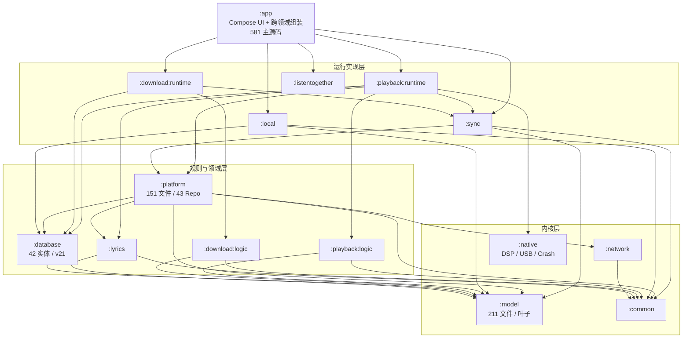

# NeriPlayer 架构点评

> 点评视角：资深程序架构设计师
> 点评日期：2026-11-16
> 点评对象：`main` 分支，HEAD `c60f846`，工作区带未提交的 QQ 音乐改动
> 说明：本文所有结论均以当前源码和配置为依据，尽量给出可复核的路径、行号与统计数字。点评只对代码与架构负责，不对产品定位或运营策略评价。

---

## 一句话总评

**这是一个「工程纪律远超行业平均、但结构债正在用行数门禁硬扛」的项目。**

它有我在业余 Android 项目里见过的最认真的一套自动化架构护栏——模块边界、字节码级依赖校验、CRAP 复杂度门禁都是真的在 CI 上跑，不是摆设。同时，它也有 1977 行的全局 `object PlayerManager`、近 2000 行还在一路逼近上限的播放扩展文件，以及「文件大小压线过关」这种把架构问题当成 KPI 来管理的味道。

一句话概括：**管理做得像一个大厂团队，代码结构还停在一个「靠自律和脚本兜底」的规模。** 值得称赞的是前者，值得警惕的是后者正在被功能迭代反超。

---

## 1. 规模与技术栈（先把底摸清）

| 维度 | 实测数据 |
|---|---|
| app 主源码 | 581 个 Kotlin/Java 文件，约 17 万行 |
| 自有库主源码 | 14 个模块，1,537 个文件 |
| 测试文件 | app 层 569 个 JVM 单测 + 260+ 个设备测试；自有库约 1,590 个；全仓 `@Test` 5,009 处 |
| Native | 163 个 C/C++ 文件（自研约 85 个，vendored libusb 51 个），8 个 CMakeLists |
| 构建 | AGP 9.4.1 / Gradle 9.6.1 / Kotlin 2.4.10 / KSP 2.3.10 / compileSdk 37 / minSdk 28 |
| UI | Jetpack Compose + Navigation Compose + Material3 |
| 播放 | Media3 (ExoPlayer) 1.10.1，自研 native DSP + USB 独占输出 |
| 网络 | OkHttp 5.4.0 单一栈（无 Retrofit / Ktor） |
| DI | **无 Hilt / 无 Koin**，手写 `AppContainer` Service Locator（784 行）+ 61 个 `object` 单例 |
| 测试框架 | JUnit4 + Mockito + Robolectric + Compose Test + coroutines-test（无 MockK / Turbine） |

这不是玩具项目，是实打实的工程级体量。下面所有讨论都建立在这个规模上——有些问题在小项目里叫「代码风格」，在这个体量里就得叫「架构债」。

---

## 2. 架构地图



依赖方向整体是自顶向下、无环的，`.gitmodules` 与 `settings.gradle.kts` 的分工清楚。这是这个项目最扎实的地基。

---

## 3. 做得好的地方（这些是真功夫）

### 3.1 质量门禁：同类项目里的天花板 ⭐

这是最值得服气的部分。`tools_pub/quality/` 下有三套互相独立、且真的挂在 `check` 和 CI 上的校验：

- **`module_boundaries.py`（567 行）**：逐模块硬编码 `ALLOWED_DEPENDENCIES` 白名单；`FORBIDDEN_IMPORT` 禁止库反向依赖 app 的 `ui.`/`activity.`/`core.di.`/`R`；`PACKAGE_OWNERS` 按包名归属判跨模块串门；DFS 检测依赖环；platform 内部还细分到「`*.api` 只允许依赖 common/model/network」并列出 8 个歌词 parser 函数的窄白名单。
- **`domain_dependencies.py`**：用 JDK `jdeps -verbose:class` 检查**编译后字节码**的直接类依赖，用 `javap -verbose -private` 校验桥接方法的完整 JVM 签名。配置 `domain-dependencies.json` 覆盖 64 个域、2,858 条白名单。粒度细到「lambda 和 Kotlin 生成类新增即纳入，漏掉任何受管类即失败」。
- **`crap_report.py`**：CRAP = `C²×(1−cov)³ + C`，阈值 >9 失败，332 条源码 pattern + 46 个方法级 scope，点了 `PlayerManager`（104 个方法）、`UsbExclusiveSessionController`（113 个方法）等巨型对象的名。明确不设平均分、不设 baseline 豁免。

根 `build.gradle.kts` 的 `verifyModularization` 把它们和 `:app:verifyDomainDependencies`、`:app:verifyCrap`、`lintDebug` 串成一条命令，`.github/workflows/android_ci.yml:109-116` 在 push/PR 上真跑。**这套东西的成熟度高过很多商业化 Android 团队。** README 里那句「9 是风险门禁，不是架构质量证明」也很清醒，没有自我感动。

### 3.2 logic / runtime 分离：真做了，不是摆设 ⭐

播放和下载都拆成纯规则层和运行层，而且是用三层手段锁死的：

1. Gradle 边界：`:playback:logic` 只依赖 `:model` + `:common`，无 Android 组件；
2. 包归属表：`core/player/policy/*`、`core/player/queue`、`core/download/{admission,retry,ownership,...}` 被脚本判给 logic 模块，放错地方直接报错；
3. 端口桥接：`PlayerDownloadAccess`（22 个方法的窄接口）让 runtime 不直接依赖 `download:runtime`——脚本第 453 行专门拦这条，报错信息都替你想好了：`use PlayerDownloadAccess instead of depending on :download:runtime`。

效果是可测的：`playback:logic` 65 个源码配 52 个测试，`download:logic` 39 配 32。规则层能脱离 Android 跑 JVM 测试，这是正经的分层收益。

### 3.3 数据层：把用户数据当回事 ⭐

`NeriUserDataDatabase` version 21，42 个实体、17 个 DAO，**20 条显式迁移**（`MIGRATION_1_2` … `20_21`），21 份 schema JSON 入库，`exportSchema = true`，**没有 `fallbackToDestructiveMigration()`**。`NeriUserDataDatabaseVersion.kt` 在开库前先读 `user_version`：`NewerThanApp` 直接抛异常拒绝打开（保护数据不被老版本 app 覆写），`Unreadable` 也拒绝并保留文件，还限制只能在主进程打开。

同步合并也不是「last write wins」糊弄：9 种 song 合并策略、并查集做身份归并、因果令牌、双边都改名生成 `MANUAL_REQUIRED` 冲突。写路径是 outbox 模式（先本地落盘、`committedIndex` 确认后再提交）。**「本地优先」这四个字在代码里是有对应实现的，不是 README 口号。**

### 3.4 测试不是补出来的

全仓 5,009 个 `@Test`。`playback:runtime` 250 源码 / 273 测试，`download:runtime` 246 / 310，`local` 203 / 382——测试比源码还多。启动、进程死亡恢复、下载续传、SAF 授权、歌词解析、车机 MediaSession 都有专门的集成测试，还有多进程测试 runner 和参数化门控。**在「测试覆盖率」这件事上，这个项目的态度无可挑剔。**

### 3.5 有真实收益的代码生成

`:ksp-processor` 979 行、`:ksp-annotations` 260 行，生成 7 类文件。看起来重，但驱动了 169 个 `@AutoSetting` 设置项，被 49 个文件消费，还带重复 key / constantName 校验。这是「写一次工具、省 169 处手写」的合理投资，不是炫技。

### 3.6 Native 自研 DSP 与 USB 独占

163 个 C/C++ 文件、自研 DSP 引擎、UAC1/UAC2 时钟拓扑与显式反馈端点、32 个独立 CTest（USB 31 + DSP 1）、四 ABI 编译 + ASan/UBSan/TSan 三组 CI。在一个音乐播放器里做到这个深度，属于少见的野心。

---

## 4. 做得不好的地方（直白版）

### 4.1 门禁已经在 HEAD 里被击穿了——我亲自跑了

在根目录执行 `python3 -B tools_pub/quality/module_boundaries.py`，**退出码 1，三条违规**：

```
platform/search/api/client/QQMusicSearchApi.kt: forbidden package dependency ...QQMusicSession
platform/search/api/client/QQMusicSearchApi.kt: forbidden package dependency ...qqMusicHash33
playback/runtime/.../url/PlayerManagerUrlExtensions.kt: 2082 lines, must remain below 2000
```

前两条是这次未提交的 QQ 音乐改动刚引入的——**说明门禁确实在实时生效**，这点值得表扬。但第三条：`PlayerManagerUrlExtensions.kt` 在 HEAD 提交态就是 2082 行（`git show HEAD:... | wc -l` 实测），**是已经进主线的违规**。

更值得玩味的是一批「压线生存」的文件：`AudioPlayerService.kt` 1998 行、`UsbExclusiveAudioSink.kt` 1998、`PlayerManagerLifecycleExtensions.kt` 1997、`PlayerManagerPlaybackExtensions.kt` 1991、`PlayerManager.kt` 1977。

**直白点评：这说明团队在陪 2000 行上限玩「贴着天花板走路」的游戏。** 行数门禁抓住了「文件太大」这个症状，却没解决「职责太多」这个病。当一个团队开始为 1998 行还是 2001 行纠结时，正确的动作是把文件拆开，而不是把逻辑挤进行数预算。这个门禁目前是**强度很高、但已经被现实磨出缺口**的状态——比没有强太多，但别把它当成结构健康的证明（README 自己也承认了这一点）。

### 4.2 全局可变单例：整个架构最大的单点

`PlayerManager.kt:285` 是 `object PlayerManager`，1977 行，里面同时攥着：

- `lateinit var application: Application`（:295）、`lateinit var player: ExoPlayer`（:296）
- 约 50 个 `MutableStateFlow`（`_currentSongFlow`、`_isPlayingFlow`、`_progressFlow` …）
- 可替换的 `ioScope` / `mainScope`（:326-327）、多个 watchdog Job + `@Volatile` token（:336-338、:352-354）
- 十几个 owner 对象（stats / usb / sound / transport / progress / route …）
- 用 `@Volatile` 布尔量和手写 token 做竞态防护（:289-293、:364-365）

这不是一个播放器组件，是**一个进程级的状态宇宙**。并发推理成本、测试隔离成本、冷启动顺序耦合（Application 里 `PlayerManager.bindApplication(this)` 必须先于 Compose 的 SideEffect，注释都写明「首个播放点击可能早于 SideEffect」）全压在这一个对象上。策略外置到 `playback:logic` 是对的方向，但只搬走了一部分——真正的「大脑」还在 object 里。

配上 `AppContainer`（784 行 Service Locator）+ app main 61 个 `object`，**整个 app 的依赖和运行态是「全局可达、全局可变」的**。这在单人/小团队项目里跑得飞快，但每加一个平台、每加一种输出设备，都要往这个全局状态机里再塞几根线。QQ 音乐这次改动为什么顺手就踩穿了包边界？因为最省事的路径就是「往 AppContainer 里再注册一个 repo」——架构在诱导你走这条捷径。

### 4.3 没有 DI 框架，代价开始显现

全仓 `@HiltAndroidApp` / `@Module` / `@Inject` / Koin 均为 0。手写 Service Locator 不是罪——但在这个体量下，它的成本已经可见：

- `NowPlayingViewModel.downloadSong(context: Context, ...)`（:357）、`resumeDownload`(:365)、`retryDownload`(:369)、`fillLyrics(context: Context, ...)`(:472)、`fetchOriginalInfo(context: Context, ...)`(:563)——**ViewModel 的业务方法让 UI 传 Context 进来**。这直接破坏 ViewModel 的纯粹性和可测试性，也是典型的 Android 架构反模式。
- `viewModelFactory { }` 样板在 8+ 个 Screen 里重复手写，因为没有一个统一的 VM 工厂/基类。
- `AndroidViewModel(application)` 一大片，VM 直接持有 Application。

**直白点评：省掉了 Hilt 的配置成本，正在用每个 Screen 的样板、每个 VM 的 Context 参数和每次改动的全局容器编辑来还债。** 这笔账在 500 个文件以后是亏的。

### 4.4 UI 架构三套范式并存

同一个 app 里：

1. **MVVM**：Home 走 `HomeUiState` + `StateFlow` + `collectAsStateWithLifecycle`（345 处）；
2. **Compose 即状态机**：`SettingsScreen.kt`（1277 行）**没有 ViewModel**，靠 `remember` + `mutableStateOf` + 一堆 controller；
3. **全局单例直连 UI**：播放页直接 collect `PlayerManager` 的全局 StateFlow，`NowPlayingViewModel`（691 行）名义上是播放页 VM，实际干的是百科/搜索/下载/歌词填充。

再加上 67 处裸 `collectAsState()`（非 lifecycle 版）和 345 处 lifecycle 版混用——同一个页面里两套收集方式都有。**这不是「灵活」，是「没有统一约束」。** 新来的人不知道该照哪套写，重构的人不知道哪套是「正确」的。

根 Composable `NeriApp.kt`（1963 行）里有约 15 个 `LaunchedEffect`，包括 `LaunchedEffect(Unit)` 做全局初始化。全 app `LaunchedEffect` 538 处、`DisposableEffect` 104 处。**副作用密度高到需要靠纪律而非结构来保证正确性。**

### 4.5 巨型文件与上帝类

实测最大的几个：

| 文件 | 行数 | 问题 |
|---|---:|---|
| `PlayerManager.kt` | 1,977 | 全局可变状态宇宙（见 4.2） |
| `NowPlayingScreen.kt` | 1,995 | UI 上帝 Composable |
| `LegacyDownloadUpgradeCoordinator.kt` | 1,972 | 一次性升级逻辑长期驻留 |
| `NeriApp.kt` | 1,963 | 根 Composable 承担过多编排 |
| `MainActivity.kt` | 1,878 | 生命周期 + 深链 + USB + 外部分享全塞一起 |
| `ExploreScreen.kt` / `HomeScreen.kt` | 1,876 / 1,866 | UI 上帝 Composable |
| `ExploreViewModel.kt` | 1,709 | 上帝 ViewModel |
| `AppContainer.kt` | 784 | Service Locator 膨胀 |

`ui` 包 480 个文件占 app 主源码 83%——**模块化主要在业务层做完了，UI 层还是「宿主里的单体」**。这在 Compose 项目里很常见，但 480 个文件、几个 1900 行的 Composable，已经超出「能靠代码审查维持」的范围。

### 4.6 平台抽象没有真正统一

四个平台（网易云、Bilibili、YouTube Music、QQ 音乐）是**按平台分包 + 各自 Repository**，共享的只有 `SearchApi`、`CommentRepository` 等窄接口。没有一个 `MusicPlatform` SPI 把「搜索 / 播放解析 / 歌单 / 关注 / 评论」抽象成统一能力。

后果已经在发生：**这次新增 QQ 音乐，直接以新包切入，并立刻触发了 2 条包依赖违规**（`QQMusicSearchApi` 读了 `qqmusic.auth` 的会话和哈希函数）。也就是说，每加一个平台，都要靠人肉同步更新质量脚本的白名单，**抽象没有携带约束，约束靠脚本补丁**。 README 的平台现状里 QQ 音乐还写着「仅用于播放页元数据和歌词补全」，而工作区改动已经在做登录、播放和库页——文档和功能进度也已经开始脱节。

### 4.7 导航参数传序列化 JSON

`Destinations.kt` 里 `playlist_detail/{playlistJson}`、`netease_artist_detail/{artistJson}`、`qqmusic_singer_detail/{singerJson}` 等约半数详情路由把整个对象序列化塞进导航参数，`NavType` 全 app 仅 13 处。代价是：类型安全缺失、配置变更/进程重建时要反序列化、参数长度受限。深链接则是 Manifest 里声明 + `MainActivity:1422 handleIncomingIntent` 手工解析，代码里 `navDeepLink` 为 0。**功能上能用，但这是「先把参数塞进去以后再拆」的债务。**

### 4.8 其他值得记一笔的

- **硬编码 URL 约 330 处**，平台 API 端点散在各处，没有统一 config/buildConfig 收口。
- **`common` 有轻度领域渗漏**：`AccountPreferencesOpener`、`ManagedDownloadDirectoryIdentity`、`ManagedDownloadAtomicFile` 等下载/账号专用类躺在通用模块里。还没烂成杂物抽屉，但有苗头。
- **编译期反向引用 app 目录二进制**：`playback:runtime/build.gradle.kts:55` 用 `compileOnly(files("app/libs/lib-decoder-ffmpeg-...aar"))`——库模块引用了 app 目录下的 AAR。物理依赖方向上的灰色地带，被质量脚本默许了。
- **license 面**：vendored `libusb`（LGPL-2.1，51 个文件）和 FFmpeg AAR 的分发合规，需要持续盯 `THIRD_PARTY_LICENSES.md`（这一点项目已经意识到，不算疏漏）。
- **git 历史很浅**：65 个提交集中在 2026-10-27 ~ 10-30 四天内。当前工作区还有 8 个 QQ 音乐相关文件处于未提交状态。历史被压缩过（也可能是备份副本的特征），意味着 `git blame` / 追溯「这个违规什么时候进来的」基本不可用——**对架构债管理来说，这是一个实际的能力缺失**。

---

## 5. 分项评分（个人判断，供参考）

| 维度 | 评分 | 说明 |
|---|---:|---|
| 模块划分与依赖方向 | 8.5 / 10 | 14 模块 + logic/runtime 分离 + 无环，地基扎实 |
| 质量护栏与自动化 | 9 / 10 | 三套门禁 + CI 真跑，行业少见；扣分在已有违规漏网 |
| 测试体系 | 9 / 10 | 数量与深度都到位，测试比源码多 |
| 数据层与本地优先 | 8.5 / 10 | 迁移、版本保护、合并策略都很认真 |
| 播放/Native 深度 | 8 / 10 | Media3 + 自研 DSP/USB 很有野心 |
| UI 架构一致性 | 5 / 10 | 三范式并存、巨型 Composable、副作用密集 |
| 依赖注入与可测试性 | 5 / 10 | Service Locator + 全局 object + Context 传入 VM |
| 平台抽象可扩展性 | 5.5 / 10 | 窄接口够用但无统一 SPI，加平台就踩边界 |
| **综合** | **7 / 10** | **工程纪律一流，结构债中等偏重，趋势需警惕** |

---

## 6. 改进建议（按优先级）

### P0 — 立刻做

1. **先还门禁的债**：把 `PlayerManagerUrlExtensions.kt` 拆到 <2000 行（按职责拆成 2-3 个文件），修掉 `QQMusicSearchApi` 的两条包依赖违规（把会话/哈希调用移到合规的 bridge 或 repo 层）。让 `verifyModularization` 真正全绿，而不是「大部分绿」。**门禁一旦允许破例，就会持续破例。**
2. **停止「贴线开发」**：把 2000 行上限从「硬约束」改成「软告警 + 80% 提醒」，同时给那批 1990+ 行文件排一个拆解计划。行数不是架构指标，但它是很好的早期预警——前提是别把它玩成数字游戏。

### P1 — 本季度做

3. **收口全局状态**：给 `PlayerManager` 定一个明确的生命周期边界（比如一个 `@Singleton` 的 `PlaybackController`，用接口暴露给 UI），逐步把 `lateinit application/player` 和非 StateFlow 的可变字段迁移到有明确 owner 的组件里。目标不是一次重写，而是**每次改动都让 object 小一点**。
4. **统一 UI 状态范式**：定一条规则——「所有屏幕用 `UiState` + `StateFlow` + `collectAsStateWithLifecycle`」，把 Settings 的 Compose-local state 和裸 `collectAsState()` 逐步收编。引入统一的 `BaseViewModel`/VM 工厂消掉重复样板。
5. **把 Context 从 ViewModel 里赶出去**：`downloadSong` / `fillLyrics` 等改成通过注入的 repository 完成，VM 只暴露意图和状态。这是提升可测试性最快的一步。

### P2 — 有计划地做

6. **建真正的平台 SPI**：定义 `MusicPlatform` 能力接口（search / resolvePlayable / playlists / follow / comments），四个平台各自实现，`AppContainer` 只持有 `Map<Source, MusicPlatform>`。这样新增平台不再需要人肉改质量脚本白名单，**约束由类型系统携带，而不是靠 Python 脚本补丁**。
7. **导航去 JSON 化**：用 Kotlinx Serialization 的 `CustomNavType` 或「ID + Repository 取数」替代 `{xxxJson}` 路由参数，顺带把深链解析从 `MainActivity` 抽到独立的 `DeepLinkHandler`。
8. **引入 Hilt**（或至少 Koin）：用 DI 框架接管 `AppContainer` 的 784 行装配，让「全局可达」变成「按需注入」，从根上抑制 Service Locator 继续膨胀。
9. **给 UI 层做模块化**：把 `ui` 包按业务域切成若干 feature module（home / explore / library / settings / player），至少先把 1900+ 行的 Composable 拆成可组合的子模块。
10. **恢复 git 历史的可追溯性**（如果这是备份副本，在主仓库补上完整历史）：架构债管理离不开 `git blame`，浅历史让「这个违规什么时候进来的、为什么」无法回答。

---

## 7. 结语

**值得肯定**：质量门禁、logic/runtime 分离、数据迁移与合并、测试深度、native DSP——这些不是靠口号堆出来的，是真金白银的工程投入。团队显然知道自己在做什么，也在认真做。

**需要警惕**：这个项目正在用「流程严格」掩盖「结构吃紧」。2000 行的贴线游戏、已经破防的门禁、1977 行的全局 object、三套并存的 UI 范式——每一个单看都能解释，合在一起就是一个信号：**功能迭代的速度已经超过结构演进的速度**。门禁能拦住违规的代码，但拦不住「为了过门禁而做出的次优设计」。

**架构建议只有一句**：把「文件行数」这个代理指标，换成「职责边界」这个真实目标。少玩行数游戏，多拆真正该拆的东西。这个项目的技术底子和工程纪律完全支撑得起一次结构升级，缺的只是优先级。

---

*本文基于静态代码阅读与本地命门禁复跑得出，未执行完整构建与测试套件。文中数字均为实测或明确标注的统计口径，如有出入以源码为准。*
